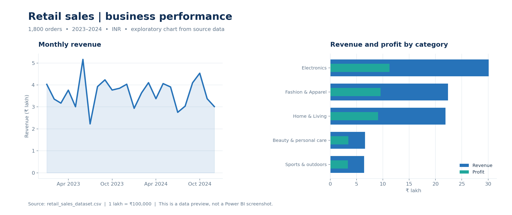

# Mary Catherine
### Aspiring Data Analyst | Business Analytics | Power BI | SQL | Python | Excel

I turn data into clear analysis and dashboards that help explain performance, identify patterns, and support better business decisions. This portfolio brings together four projects in sales, customer experience, historical market data, and operational performance.

**Focus:** Data Analyst · Business Analyst · Business Analytics roles

---

## Featured project: Retail Sales Performance & Customer Analytics

**Business question:** How do revenue and profit vary over time, across regions, product categories, and customer purchasing patterns?

The flagship project combines an interactive Power BI report with SQL queries and a Python exploratory notebook. The accompanying dataset contains **1,800 orders** and **860 distinct customers** across 2023–2024. Total recorded revenue was **₹8,738,212.45**, with **₹3,665,122.45** in recorded profit.

*This figure is a reproducible chart from the CSV, not a screenshot of the Power BI report.*

**Example insight:** Electronics generated ₹3,011,109.65 in revenue, about 34.46% of the total. A useful next step would be to examine category-level margins and discounting alongside revenue when reviewing product strategy.

[**Explore the retail project →**](projects/retail-sales/README.md)  ·  [Power BI report](projects/retail-sales/Retail_Sales_Dashboard.pbix)  ·  [SQL](projects/retail-sales/Retail_Sales_SQL_Analysis.sql)  ·  [Python notebook](projects/retail-sales/Retail_Sales_Python_Analysis.ipynb)

---

## More projects

| Project | Business focus | What to explore | Data |
|---|---|---|---|
| [Customer Interaction Quality Analysis](projects/customer-interaction/README.md) | Customer experience, service quality and team performance | QA scores, satisfaction, resolution and recurring quality gaps | **Synthetic**, 3,000 interactions |
| [Coca-Cola Stock Market Analysis](projects/coca-cola-stock/README.md) | Historical time-series analysis | Price trends, moving averages, trading volume and volatility | Historical prices in the report; separate source not supplied |
| [Screening Case Pattern Review](projects/screening-case-operations/README.md) | Operational workload and process efficiency | Case volumes, priority, status and turnaround | **Synthetic**, 3,000 cases |

---

## Analytical toolkit

- **Data preparation:** data cleaning and transformation, data quality checks, Excel and Power Query.
- **Analysis:** SQL, Python, pandas, exploratory data analysis, trend analysis and descriptive statistics.
- **Business intelligence:** Power BI, DAX, KPI development, interactive reporting and data visualization.
- **Decision support:** translating findings into practical questions and recommendations for stakeholders.

The included SQL and notebook relate to the retail project. An Excel workbook is not included; Power BI Desktop is required to open the `.pbix` files. The customer interaction and screening projects use clearly labeled synthetic data. No results in this portfolio should be interpreted as verified improvements to a real business.

## How to explore

1. Open a project page above for its business question, findings, methods, and limitations.
2. Download a `.pbix` file and open it in **Power BI Desktop** to interact with the report. A data-source path may need to be updated if you refresh it.
3. For retail SQL and Python, use the project instructions and the included CSV. The [repository guide](GETTING_STARTED.md) explains the folder structure and setup.

*Figures are descriptive of the datasets provided. They are not investment advice, proof of causation, or claims of business outcomes.*
