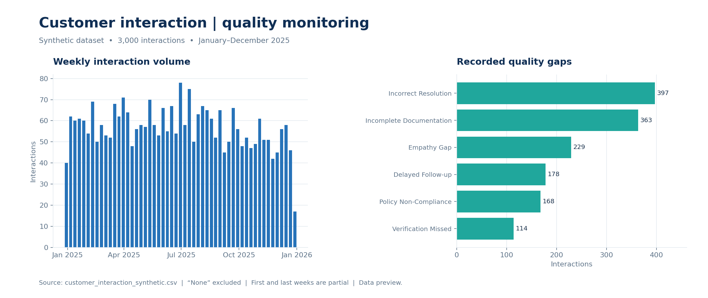

# Customer Interaction Quality Analysis

[← Portfolio home](../../README.md)  ·  **Synthetic data**

## Business question

How can interaction quality, customer feedback, and resolution performance be monitored to identify practical coaching and process-improvement opportunities?

## Project overview

The Power BI report explores **3,000 synthetic interactions** from January through December 2025. It brings together quality-assurance (QA) scores and pass rates, customer satisfaction, first contact resolution (FCR), service-level agreement (SLA) compliance, weekly volumes, team comparisons and quality gaps.

*Charts above are generated from the synthetic CSV, not screenshots of the Power BI report. The first and last weeks are partial.*

## Findings from the synthetic CSV

- **Quality gaps:** Incorrect resolution was recorded on **397 interactions**, and incomplete documentation on **363**. The category “None” is excluded from the gap counts.
- **Team QA:** Billing & Payments had the lowest average QA score, **81.72/100**, among the teams in this dataset.
- **Customer feedback:** Email had an average satisfaction score of **3.80/5**, based on **500 responses**. Across all channels, **2,279 valid survey responses** averaged approximately **3.92/5**.
- **Resolution:** FCR was **58.37%** and the escalation rate was **14.57%** of all 3,000 interactions.

## Decision opportunities

Review resolution checks and documentation practices using the two most frequent recorded quality gaps. Explore email feedback and the Billing & Payments QA results, taking team volume and case mix into account before targeting coaching. Track changes in the same measures over time; these are recommendations for a hypothetical operation, not evidence of improvement.

## Method and files

- QA pass, FCR, and escalation rates use the sum of the relevant 0/1 flag divided by interaction count. This snapshot has unique interaction IDs.
- Average customer satisfaction includes only valid, answered surveys; unanswered responses are excluded.
- [Customer_Interaction_Dashboard.pbix](Customer_Interaction_Dashboard.pbix) — interactive Power BI report.
- [customer_interaction_synthetic.csv](customer_interaction_synthetic.csv) — synthetic source data.

Open the PBIX in Power BI Desktop. A source path may need updating if you refresh it. The displayed results and slicer behavior have not been independently verified in Desktop during portfolio assembly.

## Limitations

The dataset is synthetic and does not represent a real company or customer experience. Differences across teams and channels are descriptive and may reflect case mix or sample sizes. No separate SQL script, Excel workbook, or original Python notebook was supplied for this project.
