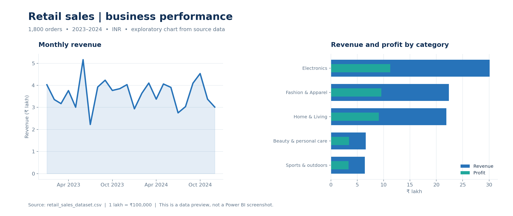

# Retail Sales Performance & Customer Analytics

[← Portfolio home](../../README.md)  ·  **Flagship project**

## Business question

How can sales, profitability, product mix, and customer purchasing patterns be monitored to support better commercial decisions?

## Project overview

This project brings together a Power BI dashboard, SQL analysis, and a Python notebook. The dataset contains **1,800 unique orders** and **860 distinct customer IDs**, dated **1 January 2023 to 31 December 2024**. Currency values are Indian rupees (INR). The supplied files do not establish whether the retail dataset is synthetic or its original source, so its provenance should be confirmed before treating it as real business performance.

*Exploratory charts generated from the CSV; the Power BI report is a separate interactive file.*

## Analytical workflow

1. **Check the data:** inspect missing fields, order IDs, date coverage, and numeric columns before analysis.
2. **Transform and explore:** in Python, convert order dates, derive weekday/weekend labels and order-level profit margins, and examine distributions and correlations.
3. **Query business performance:** use SQL to aggregate revenue, profit, orders, customers, regions, categories and channels.
4. **Build reporting views:** use the Power BI report’s DAX measures and filters to present sales KPIs and comparisons. The report’s calculations still need a Desktop check.
5. **Interpret results:** translate patterns into questions for product, pricing, and regional performance reviews.

Excel and Power Query are part of the broader toolkit; an Excel workbook and a separate record of Power Query transformation steps were not supplied with this project.

## Key findings from the supplied CSV

| Measure | Result | Definition |
|---|---:|---|
| Revenue | ₹8,738,212.45 | Sum of recorded sales revenue |
| Profit | ₹3,665,122.45 | Sum of recorded profit |
| Profit margin | 41.94% | Total profit ÷ total revenue |
| Orders | 1,800 | Distinct order IDs |
| Average order value | ₹4,854.56 | Total revenue ÷ distinct orders |
| Customers | 860 | Distinct customer IDs |

- **Product mix:** Electronics generated ₹3,011,109.65 in revenue, or **34.46%** of total revenue. Its recorded profit was ₹1,124,389.65.
- **Regional performance:** South generated the highest recorded regional revenue, **₹2,647,433.05**.
- **Time trend:** Revenue was ₹4,453,667.35 in 2023 and ₹4,284,545.10 in 2024, a **3.80% decrease**. These are descriptive comparisons; the data alone does not explain the change.
- **Discounts and margin:** The notebook calculates a Pearson correlation of approximately **−0.471** between order-level discount percentage and profit margin. This is an association, not evidence that discounting caused a change in margin.

## Decision opportunities

- Review category revenue alongside margin before deciding which products to promote; higher revenue does not necessarily mean the highest margin.
- Investigate the change in 2024 revenue by region, category, order count, and average order value before choosing a response.
- Examine discounting and product mix in more detail, and test any proposed pricing changes before drawing causal conclusions.

These are possible next steps based on the sample, not claims that any actions were taken or improvements achieved.

## Files

| File | Purpose |
|---|---|
| [Retail_Sales_Dashboard.pbix](Retail_Sales_Dashboard.pbix) | Power BI overview with revenue, profit, orders, average order value, trends, categories and region/channel filters |
| [Retail_Sales_SQL_Analysis.sql](Retail_Sales_SQL_Analysis.sql) | Read-only SQL queries for sales, customers, products, regions and channels |
| [Retail_Sales_Python_Analysis.ipynb](Retail_Sales_Python_Analysis.ipynb) | Exploratory notebook for order values, discount/margin correlation and weekday/weekend patterns |
| [retail_sales_dataset.csv](retail_sales_dataset.csv) | Dataset used for these checks and analyses |

The supplied SQL was adapted to remove database deletion and fix statement termination. The supplied notebook was adapted to locate the CSV from the repository root or this project folder and to use a standard Python kernel. The Power BI report is provided as supplied.

## How to run

**Power BI:** Download the `.pbix` and open it with Power BI Desktop. The embedded data should be available when the file opens; refreshing can require updating the original source path.

**Python:** From the repository root, install the packages with `pip install -r requirements.txt`, start JupyterLab, and open the notebook. Run the cells in order. Alternatively, open the notebook from this project folder.

**SQL:** In MySQL Workbench, create or select a database, use the Table Data Import Wizard to import the included CSV into a table named `retail_sales`, and select that database as the default schema. Ensure `Order_Date` is a date or ISO-formatted date string and revenue, profit, discount, and quantity fields are numeric. Open the SQL file and run its read-only statements. Queries were also checked against the CSV in SQLite; execution in MySQL Workbench has not been verified here.

## Data checks and limits

- The included CSV has 1,800 rows, 1,800 distinct order IDs, and no missing fields in this snapshot.
- Average order value assumes revenue is attributed correctly to each order. The current data has one row per order; this assumption should be revisited if future data contains multiple rows per order.
- The dataset is a historical sample, not a forecast. Findings reflect recorded fields and the period shown; data source and business context have not been independently verified.
- The `.pbix` layout, DAX calculations and slicers were not independently tested in Power BI Desktop during portfolio assembly. Compare the report with the CSV before relying on its displayed values.
