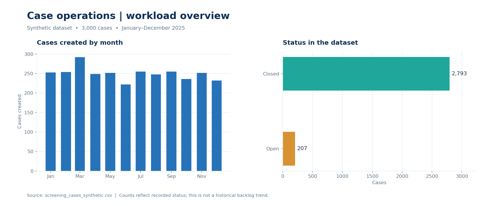

# Screening Case Pattern Review

[← Portfolio home](../../README.md)  ·  **Synthetic data**

## Business question

How can case volumes, workload mix, turnaround, and open cases be tracked to identify possible process-efficiency opportunities?

## Project overview

This is an **operational analytics** project using **3,000 synthetic cases** created from January through December 2025. The report explores monthly case volume, priority, alert categories, status, escalation, SLA compliance and open workload.

*Exploratory charts from synthetic data. The status chart shows the recorded snapshot; it is not a historical backlog trend.*

## Findings from the synthetic CSV

- **Volume:** March had the highest monthly case creation count, **292**.
- **Recorded status:** **2,793 cases** were marked closed and **207** open in the supplied data snapshot.
- **Priority:** **509 cases** had High or Critical **case priority**. This is a priority field and is not the same as customer risk rating.
- **Turnaround:** The **2,793 closed cases** averaged approximately **32.65 resolution hours**. Closed-case SLA compliance was approximately **78.20%**.

## Decision opportunities

Review workload distribution and the March volume peak when planning capacity. Examine the open cases and closed cases that missed SLA to understand where queues, handoffs, or evidence collection may slow progress. Compare teams only after accounting for workload and case complexity. These are hypothetical opportunities; no outcomes are claimed.

## Method and files

- Total cases use distinct `Case_ID`; the supplied snapshot has no duplicate IDs.
- Resolution time and SLA compliance use **closed cases only**. All closed cases in this snapshot have values for both fields.
- Escalation rate uses escalated cases divided by total cases. Customer risk rating, case priority and case outcomes are distinct concepts.
- [Screening_Case_Dashboard.pbix](Screening_Case_Dashboard.pbix) — interactive Power BI report.
- [screening_cases_synthetic.csv](screening_cases_synthetic.csv) — synthetic case data.

Open the PBIX in Power BI Desktop. The source path may need updating if you refresh it. Its displayed results and slicers have not been independently verified in Desktop during portfolio assembly.

## Limitations

The data is synthetic, and potential alerts are review indicators, not evidence of wrongdoing. The dataset is a snapshot and cannot by itself establish a historical backlog trend. No separate SQL script, Excel workbook, or original Python notebook was supplied for this project.
